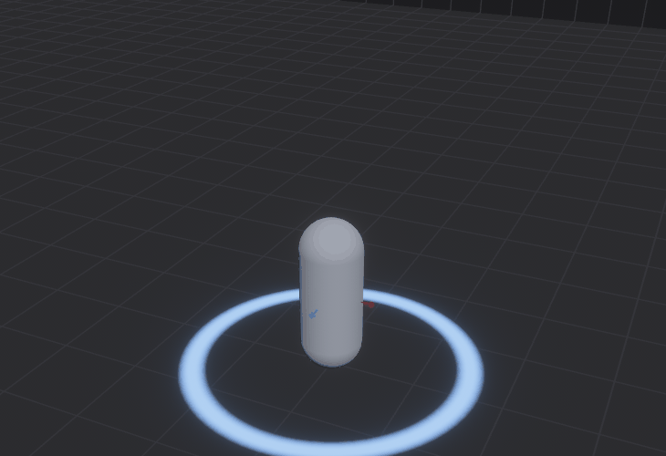
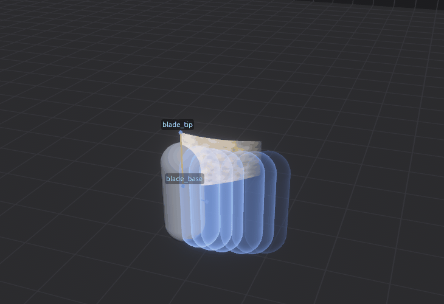
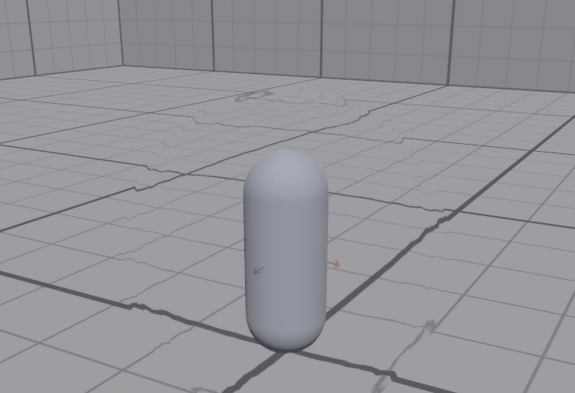

# OMAGARI

A visual effects editor and runtime for [Bevy](https://bevyengine.org) 0.19, built on [bevy_hanabi](https://github.com/djeedai/bevy_hanabi) GPU particles. Make effects in the editor, by hand or with Claude, and play them in your own Bevy game.


> [!WARNING]
> **This is a personal fork, maintained with AI assistance.**
>
> This fork of [hexroll/omagari](https://github.com/hexroll/omagari) is kept up to date for my own game. Most changes here (Bevy/Hanabi version upgrades, bug fixes, new features) are written with the help of AI coding tools. I review the changes and fix the bugs I hit while using the editor, but:
>
> - **There is no guarantee that everything works.** Features I don't use myself may be broken without me noticing.
> - **The fork will grow extensions** beyond the original editor (extra modifiers, editor tools, workflow changes) as my game needs them. They may change file formats or behaviour without notice.
> - **Compatibility is tied to my game's Bevy version**, not to a release schedule.
>
> You're welcome to use it, but treat it as experimental. For the original, hand-written editor, see the [upstream repository](https://github.com/hexroll/omagari).

## What it is

Omagari has three parts:

- **The editor** (`omagari`, the `editor` feature): build an effect from layers, tune it with a live preview on a capsule or your own animated character, and export it as a package (`<name>.vfx.ron`).
- **The library** (`omagari` crate, no features): add `OmagariPlugin` to your game, load a package and play it on any entity. Your game drives it with parameters and triggers.
- **An MCP server** (`omagari --mcp`): Claude Code can create, check, describe, tune and export effects, while you watch them in the editor.

## Features

**Seven layer kinds**, combined freely in one effect:

| Layer | For |
| :-- | :-- |
| ✨ **Particles** | bevy_hanabi GPU particles: sparks, smoke, fire, magic; GPU ribbons; 3D mesh particles (debris, shards). Nearly every bevy_hanabi 3D modifier and expression. |
| 🎨 **Surface** | A shader drawn over your character's own model: glowing skins, poison patterns, frost from the feet up, energy shells with thickness. |
| 🔷 **Shape** | Spheres, rings, cylinders, cones, quads and slash arcs with the same shader: shield bubbles, ground rings, shockwaves. |
| 〰 **Trail** | A ribbon between two moving sockets: sword swings, comet tails. |
| 👥 **Afterimage** | Fading copies of the target's meshes: sword shadows, dash echoes. |
| 💡 **Light** | Point lights: weapon glows, hit flashes, flickering torches, with a global cap. |
| 🌊 **Distortion** | Bends what is behind it: heat haze, shockwave ripples, aura shimmer. |

| Shape | Trail and afterimages | Distortion |
| :-: | :-: | :-: |
|  |  |  |

- **Parameters and triggers**: an effect declares named values (`intensity`, `charge`, `tint`) and events (`hit`, `tick`, `swing_start`) that your game sets and fires. Any layer value can follow a parameter or the layer's age; layers can play on a trigger, while a parameter is high, or between two triggers.
- **Sockets and fit**: attach layers to bones (a hand, a blade's tip) or to a segment between two sockets, and scale effects to the target's size.
- **Asset library**: import PNG / JPG textures and glTF meshes into your game's folder, view channels, extract channels; eight built-in textures ship inside the library.
- **Model preview**: your own glTF characters with animations from other files, root-motion removal, a weapon in the hand, a hierarchy browser and draggable sockets.
- **Live preview through the game's runtime**, undo / redo, and the same checks as the MCP server in the editor.

## Quick start

```text
git clone https://github.com/NazarZubyk/omagari
cd omagari
cargo run --release --features editor     # or start.bat (Windows) / ./start.sh
```

In the editor: **OPEN → `blade_swing`** (or **NEW → From a recipe**), tune it, **EXPORT** (Ctrl+E). Then in your game:

```rust
use bevy::prelude::*;
use bevy_hanabi::prelude::*;
use omagari::{VfxCommandsExt, VfxPackage};

fn main() {
    App::new()
        .add_plugins((DefaultPlugins, HanabiPlugin, omagari::OmagariPlugin))
        .add_systems(Startup, setup)
        .run();
}

fn setup(mut commands: Commands, asset_server: Res<AssetServer>) {
    commands.spawn((Camera3d::default(), omagari::distortion_camera(), Transform::from_xyz(0.0, 3.0, 6.0).looking_at(Vec3::ZERO, Vec3::Y)));
    let package: Handle<VfxPackage> = asset_server.load("vfx/my_effect.vfx.ron");
    let target = commands.spawn((Transform::default(), Visibility::default())).id();
    commands.spawn_vfx(&package, target); // plays on `target`; VfxControl sets parameters and fires triggers
}
```

with `omagari = { git = "https://github.com/NazarZubyk/omagari", branch = "master" }` and `bevy_hanabi = "0.19"` in `Cargo.toml`. A complete program: `cargo run --release --example game_integration`.

## Documentation

| Page | What is in it |
| :-- | :-- |
| [Getting started](docs/GETTING_STARTED.md) | Install, first run, your game's assets folder, demos, a first effect step by step, export. |
| [The editor](docs/EDITOR.md) | Every tab, stages, cameras (and matching your game's camera), shortcuts, each layer kind. |
| [Models](docs/MODELS.md) | Previewing on your own characters and weapons, animations, sockets on bones, the demos' models. |
| [Game integration](docs/GAME_INTEGRATION.md) | The library: plugins, camera, loading, spawning, `VfxControl`, patterns (status effects, weapon trails, hits, progression), sockets, lights, hot reload. |
| [File format](docs/FORMAT.md) | Every field of `*.omagari.ron` / `*.vfx.ron`, with defaults and examples. |
| [Claude / MCP](docs/MCP.md) | Setting up the MCP server, the tools, the workflow. |
| [Authoring guide](docs/CLAUDE_VFX_GUIDE.md) | Written for Claude, also the deepest reference: modifiers, expressions, recipes, design tips. |
| [Development](docs/DEVELOPMENT.md) | Building, testing, goldens, screenshot flags. |
| [VFX system plan](docs/VFX_SYSTEM_PLAN.md) | The design document and roadmap of the VFX system. |

## Compatibility

| `Omagari`    | `bevy_hanabi` | `bevy` | Notes |
| :--          | :--           | :--    | :--   |
| `0.19`       | `0.19`        | `0.19` | This fork, AI-assisted upgrade; VFX packages and the seven layer kinds |
| `0.17`       | `0.17`        | `0.17` | Upstream |
| `0.16`       | `0.16`        | `0.16` | Upstream |

Files: projects and packages use format version 2; version 1 projects still load and are converted. Legacy `*.hanabi.ron` exports of Omagari 0.19 still load as `EffectComplex`; those of 0.17 or older do not (see [Game integration](docs/GAME_INTEGRATION.md#14-legacy-hanabiron-files)).

## Background

This editor was written as an internal tool for the development of [hexroll3](https://hexroll.app). Following requests by the Bevy community, it was open-sourced as-is. Omagari uses bevy_hanabi's public API only.

## Contributions

This code could use your care :) so contributions are more than welcome, and [showcasing](https://github.com/hexroll/omagari/discussions/1) your effects for others to learn from is highly encouraged. [Development](docs/DEVELOPMENT.md) explains how to build and test.

## License

Similar to Hanabi, Omagari is dual-licensed under either:

- MIT License ([`LICENSE-MIT`](./LICENSE-MIT))
- Apache License, Version 2.0 ([`LICENSE-APACHE2`](./LICENSE-APACHE2))

at your option.

`SPDX-License-Identifier: MIT OR Apache-2.0`
