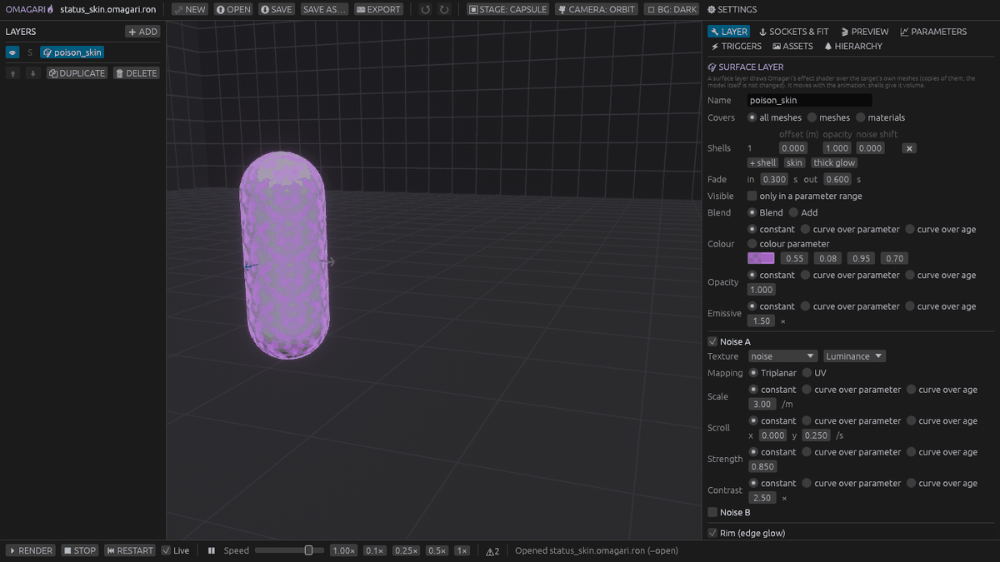

# The editor

A tour of the Omagari editor: the window, every tab, the preview stages and cameras, and one section per layer kind. Hover any label in the editor for a short explanation with units.



- [The window](#the-window)
- [Toolbar](#toolbar)
- [LAYERS list](#layers-list)
- [Right-hand tabs](#right-hand-tabs): [LAYER](#layer), [SOCKETS & FIT](#sockets--fit), [PREVIEW](#preview), [PARAMETERS](#parameters), [TRIGGERS](#triggers), [ASSETS](#assets), [HIERARCHY](#hierarchy)
- [Bottom bar](#bottom-bar)
- [Undo, saving and shortcuts](#undo-saving-and-shortcuts)
- [Stages](#stages)
- [Cameras](#cameras)
- [Layer kinds](#layer-kinds): [particles](#particles), [surface](#surface), [shape](#shape), [trail](#trail), [afterimage](#afterimage), [light](#light), [distortion](#distortion)
- [Settings file](#settings-file)

## The window

- **Top**: the toolbar.
- **Left**: the LAYERS list of the open project.
- **Middle**: the 3D preview. It plays the effect through the same runtime a game uses, so what you see is what the game shows.
- **Right**: tabs that edit the selected layer and the project.
- **Bottom**: playback, the problems counter and the status line.

The preview room is a cube 40 m wide with a 1 m grid on every face (a darker line every 5 m) and small axes at the spawn point (X red, Y green, Z blue), so you can judge sizes and keep your orientation.

A **project** is one effect. It is saved as `saved_effects/<name>.omagari.ron` and exported as a **package** `<name>.vfx.ron` for games ([FORMAT.md](FORMAT.md)).

## Toolbar

| Control | What it does |
| :-- | :-- |
| project name | The open project; `• unsaved` when it has changes. |
| **🌌 NEW** | An empty project, or one from a recipe of the authoring guide (tested, ready-made effects). |
| **⮉ OPEN** | Opens a project from `saved_effects/`. |
| **⮋ SAVE**, **SAVE AS…** | Saves to `saved_effects/` (always the current format, v2). |
| **EXPORT** | Writes the package `<name>.vfx.ron` to `<game assets>/vfx/`, or to `exported_effects/` when no game assets folder is set. The project must be saved first: the package is named after it. |
| undo / redo | See [Undo](#undo-saving-and-shortcuts). |
| **▣ STAGE** | Where the effect plays: AIR, FLOOR, OBJECT, CAPSULE, MODEL ([Stages](#stages)). |
| **🎥 CAMERA** | ORBIT or GAME ([Cameras](#cameras)), focus on the target (F), camera settings. |
| **◐ BG** | The backdrop: a light room, a dark room, black. Glow is easier to judge on dark or black. |
| **⚙ SETTINGS** | The game assets folder and the camera profiles ([Settings file](#settings-file)). |

The stage, the camera and the backdrop are saved in the project's `preview` block. That block is for the editor only and is not part of the exported package.

## LAYERS list

A project is a list of **layers**. Each layer is one visual part: particles, a surface skin, a shape, a trail, afterimages, a light or a distortion.

- Click a layer to edit it in the LAYER tab.
- **➕ ADD** adds a layer of any kind: ✨ particles, 🎨 surface, 🔷 shape, 〰 trail, 👥 afterimage, 💡 light, 🌊 distortion.
- **⬆ / ⬇** reorder, **DUPLICATE**, **DELETE** (asks first). Right-click a layer for the same commands.
- **👁** hides a layer and **S** solos it, in the preview only (nothing about this is saved; a hidden parent still spawns its child layers).
- A `⛔` / `⚠` badge shows that the layer has errors / warnings.
- Particle layers with a **parent** are indented under it (the parent's particles spawn them; see the guide's "hierarchy" section).

## Right-hand tabs

### LAYER

The inspector of the selected layer: its problems first, then its settings. Each layer kind has its own inspector, described under [Layer kinds](#layer-kinds). Most kinds have **preset** buttons that fill in a typical look (a shield bubble, a sword trail, a weapon glow, ...).

Many values can be **bound** instead of being a plain number:

- **constant**: one value;
- **curve over parameter**: keys `(parameter value → layer value)`, so the game drives it (see [PARAMETERS](#parameters));
- **curve over age**: keys `(seconds since the layer started → value)`, for things that grow, fade or flash over time;
- for colours, **colour parameter**: the game sets the colour.

### SOCKETS & FIT

- **Sockets** are named points on the target: a node or bone of the model (for example `mixamorig:RightHand`) or none (the target's origin), plus an offset in metres. A layer's **Attach** picks the target, a socket, or a **segment** between two sockets (a blade from base to tip).
- With a model on the MODEL stage, sockets show as labelled dots (segments as lines). Drag a dot, type the offset, or use the nudge buttons. The node picker lists the preview model's nodes.
- A socket whose node is not in the preview model is labelled `(node not found)` and sits at the target's origin, like it would in a game.
- **Fit** scales the effect to its target: none, the target's scale, or the target's height against a reference height (an aura made for a 1.8 m character also fits a 4 m ogre).

### PREVIEW

How the preview plays; saved with the project, not exported.

- Stage, camera and backdrop (also in the toolbar).
- **Target motion**: off, a circle (radius) or back and forth (distance), at a speed in m/s (3.6 = a running character). `Local` layers stay on the moving target; `Global` layers leave a trail behind it.
- **Model**: the model file, the root height, the animation file and clip, its speed, **In place** (remove root motion), **Instance on** (body or weapon), **Attach to** (a node), and a **Weapon**. See [MODELS.md](MODELS.md).
- Problems with the model (a missing file, an unknown node) are listed here in red.

### PARAMETERS

**Parameters** are named values the game sets on a playing effect: a number (with a range) or a colour. Examples: `intensity` 0–1, `charge` 0–1, `tint`.

- **➕ ADD PARAMETER**; rename (every use is renamed too); number or colour; default; range; **smoothing** (seconds the value takes to follow a change).
- Each parameter has a live **Preview** slider or colour picker that drives the preview exactly like the game's `set_param`, and **↔ animate** (min → max → min).
- Layers use parameters through curves (see [LAYER](#layer)), a particle layer's **Rate** (particles per second) and **Visible** (the layer shows only inside a parameter range), and **Play: While** (on while the parameter is above a threshold).

### TRIGGERS

**Triggers** are named events the game fires: `hit`, `tick`, `swing_start`.

- **➕ ADD TRIGGER**, rename, remove.
- **⚡ FIRE** fires it now; **🎯 at random point** fires it with a position on the model or capsule (like the game's `trigger_at` with a contact point).
- **auto-fire every N s** repeats it while you tune; **fire at clip time** fires it at a moment of the preview animation (each loop), for example a swing's hit frame.
- **Pulses**: on the trigger, a number parameter jumps to a value and returns over `decay` seconds (a flash on each damage tick).
- Layers react with **Play: OnTrigger** (play once per trigger) or **Play: Between** (from a start trigger until a stop trigger, for example sparks only during a swing).

### ASSETS

The project's textures and meshes.

- **📥 IMPORT…** (a file dialog) or drop PNG / JPG files onto the window. A file outside the game assets folder is copied into `<game assets>/vfx/textures/` (a different file with the same name gets `_2`, `_3`, ...; the same file again is reused). A file already inside the game assets folder is used where it is.
- **➕ BUILT-IN** adds one of the 8 textures built into the library (seven particle sprites and a tileable noise). They need no files in your game.
- Each texture has an **id** (what layers pick), a **purpose** (Sprite, Noise, Mask, Gradient; guessed from the file name) and settings that default from it: **wrap** (Repeat tiles, Clamp stretches the edge), **colour space**, **filter** (smooth or pixelated) and a **sprite sheet** grid.
- Click a texture for a large preview with **RGB / R / G / B / A** buttons, the layers that use it, **RENAME**, **DELETE** (only while unused) and **EXTRACT CHANNEL**, which writes one channel as a grayscale PNG next to the file and adds it as a new texture. Particle layers can only read a texture's colour or its red channel, so a texture with different masks packed into R, G, B and A needs this for G, B and A. Surface, shape and other shader layers pick the channel per slot.
- **Models** (`.glb`, or a `.gltf` already in the game assets folder) imported the same way become **mesh assets** for mesh particles. A `.glb` from outside is copied to `<game assets>/vfx/models/`.
- Missing files, paths outside the game assets folder and settings that fight the purpose (Noise with Clamp) show as warnings.
- Formats: PNG everywhere; JPG needs Bevy's `jpeg` feature in the game (the editor has it); KTX2 files can be referenced but have no preview.

### HIERARCHY

The preview model's nodes, bones, meshes and materials as a searchable tree. Per node: **🎯** attaches the preview instance to it, **⚓+** adds a socket on it, **A** / **B** make it the selected layer's segment start / end. Mesh and material names are what surface layers and afterimages cover.

## Bottom bar

| Control | What it does |
| :-- | :-- |
| **RENDER** (Space) | Rebuilds the effect and plays it from the start. |
| **STOP** | Stops it the way a game does: no new particles, live ones finish, layers fade out. |
| **RESTART** | Clears every particle and plays again. |
| **Live** | Rebuild the preview a moment after each edit. |
| **⏸** and **Speed** | Pause and slow down the preview (0.1×, 0.25×, 0.5×, 1×). |
| animation controls | With an animated model: pause, loop, a time slider to scrub, speed. |
| problems counter | The project's errors and warnings: the same checks as the MCP `check_project`. Click it for the list. `⚠ n build` lists warnings of the last preview build. |
| status line | What just happened (opened, saved, exported, a missing preview model, ...). |

## Undo, saving and shortcuts

- **Undo / redo** cover every project edit: layers, sockets, fit, parameters, triggers, assets, the preview block. A drag or a typed word is one step.
- NEW, OPEN, a preview request from Claude and closing the window ask before throwing away unsaved changes.
- Delete (`X`) buttons inside the modifier lists need a **right-click**, so you don't delete a modifier by accident.

| Shortcut | Action |
| :-- | :-- |
| Ctrl+S | Save |
| Ctrl+E | Export |
| Ctrl+Z | Undo |
| Ctrl+Y / Ctrl+Shift+Z | Redo |
| Delete | Delete the selected layer |
| Ctrl+D | Duplicate the selected layer |
| F | Focus the camera on the target |
| Space | Render (play again) |

On macOS, Ctrl is Cmd. While a text field has focus, only Ctrl+S and Ctrl+E work.

## Stages

The stage is what stands at the spawn point (the **target**: in a game, the entity the effect is attached to).

| Stage | What you see | Use it for |
| :-- | :-- | :-- |
| **AIR** | Nothing near the spawn point, in the middle of the room. | Particles that fall below the spawn point; seeing everything. |
| **FLOOR** | The floor at the spawn point. Particles below it are hidden. | Ground effects, impacts. |
| **OBJECT** | A rock about 2 m wide on the spawn point. | Shields, barriers, auras around objects. |
| **CAPSULE** | A 0.7 × 1.8 m capsule whose centre is the target, standing on the floor. | Character effects without a model: surface skins, afterimages, sockets as offsets. |
| **MODEL** | Your glTF model, optionally animated and holding a weapon. Without a model (or with a missing file) the capsule. | Character and weapon effects on the real thing. See [MODELS.md](MODELS.md). |

The capsule's 1.8 m height and its centre as the target (0.9 m above the feet) match a typical character collider; with a model, **Root height** says how far above the model's feet your game's entity root is.

## Cameras

The preview has two camera presets. Each is a **render profile** in ⚙ SETTINGS: projection, visible height or field of view, yaw, pitch, distance, tonemapping, bloom, exposure and background. Edits apply live; **⮋ Save camera settings** writes them to `omagari_settings.ron`.

- **ORBIT**: the free camera. Drag to orbit, right-drag to pan, wheel to zoom, **F** to focus on the target. Its yaw, pitch and distance are where it starts.
- **GAME**: should match **your game's camera**, so you judge sizes and glow the way players will see them. It follows the preview target. The default is an orthographic, true isometric camera (yaw 45°, pitch 35.26°) showing 16 m from the bottom to the top of the view, with HDR and Bevy's `Bloom::NATURAL`. Change it to your game's values:

| Your game's camera | GAME profile |
| :-- | :-- |
| `Projection::Orthographic` with `ScalingMode::FixedVertical { viewport_height: h }` | Projection **Orthographic**, **Visible height** `h` m |
| `Projection::Perspective` with `fov` (radians) | Projection **Perspective**, **Field of view** in degrees |
| camera offset `(x, y, z)` from the player | **Yaw** = atan2(x, z), **Pitch** = atan2(y, √(x² + z²)), **Distance** = √(x² + y² + z²) |
| `Tonemapping`, `Bloom`, `Exposure` | the same settings |

For example an offset of `(20, 20, 20)` gives yaw 45°, pitch 35.26°, distance 34.64 m. Yaw 0° looks from +Z towards −Z.

## Layer kinds

Every layer has a **name**, a **Play** mode (when it plays), and usually **Attach** (target, socket or segment), **Fade** (in when it starts, out when the game stops it), **Visible** (only inside a parameter range) and **Draw order** (metres added to its sort distance, to draw it over or under other see-through things at a similar distance).

**Play** modes:

| Mode | Plays |
| :-- | :-- |
| **Loop** | For as long as the effect runs. |
| **OnStart** | Once when the effect starts. |
| **OnTrigger** | Each time the game fires the trigger (not at the start). |
| **While** | While a number parameter is at or above a threshold. |
| **Between** | From a start trigger until a stop trigger. The same trigger twice toggles it. |

Shapes, lights and distortions also have a **Duration**: it makes `OnStart` / `OnTrigger` one-shots (they fade in and out inside it, then are gone) and repeats the age of `Loop` / `While` layers.

### Particles

A **particle layer** is one bevy_hanabi GPU particle effect: sparks, smoke, fire, magic, debris.

- **Capacity** (most particles alive at once), **Texture**, **Mesh** (the default quad, a built-in 3D shape or a mesh asset), **Parent layer** (spawned by another layer's particles), **Space** (**Local**: particles move with the target; **Global**: they stay where they were born and trail behind a moving target), **Attach**, **Play**, **Rate**, **Visible**, **Draw order**, **Blend** (Blend, Add for glow, Premultiply, Multiply, Mask, Opaque), **Motion** (when velocity moves particles), **Simulate** (only when visible, or always), **Random seed**.
- **Spawner**: how many particles and when, with **Once / Rate / Burst** presets.
- **Init / Update / Render** modifiers: what happens when a particle is born, every frame, and how it is drawn. The **+** menus are grouped (Position, Velocity, Forces, Kill, Events, Color / Size, Texture / Flipbook, Orientation) and cover nearly every bevy_hanabi 3D modifier. Values are **expressions**: a constant, a random range, a parameter, a property, or any bevy_hanabi operator.
- **✨ PRESETS**: ribbons ("magic streaks", "swirl around the target", "streak behind the emitter") and mesh particles ("debris burst", "glowing shards").
- **Ribbons**: particles with the same `ribbon_id` are drawn as one strip (bevy_hanabi's GPU ribbons). A weapon's swing arc is better as a [trail](#trail).
- **Mesh particles** are drawn **unlit**, one flat colour per particle (a bevy_hanabi limit): vary the colour per particle; use Opaque for solid debris or Add for glowing shards.
- **Limits** (bevy_hanabi 0.19): random values at render time are the same for every particle; integer random values and some operators (`Asin` / `Acos` of a constant outside −1..1) do not compile; the checks report these.

The authoring guide ([CLAUDE_VFX_GUIDE.md](CLAUDE_VFX_GUIDE.md), sections "spawner", "modifiers", "expressions", "attributes", "render") explains every modifier and expression.

### Surface

A **surface layer** draws Omagari's effect shader over the target's own model: a poison skin with crawling noise, an energy field with thickness, frost creeping up from the feet. The model and its materials are never changed: the effect is drawn on copies of the model's meshes that follow every animation frame.

- **Covers**: all meshes, some meshes, or the meshes with some materials.
- **Shells**: each shell is one copy pushed outward by an offset in metres. One shell at 0 = a coloured skin; two or three at 1–4 cm = a glow with volume (presets "skin" and "thick glow").
- **Material** (shared by surface, shape, trail and afterimage layers): **Blend** (covers by opacity) or **Add** (adds light), **colour** (HDR), **opacity**, **emissive**; up to two scrolling **noise** textures (a texture and its channel; **Triplanar** mapping in the model's rest pose so the pattern sticks to the moving body, or the mesh's UVs; scale, scroll, strength, contrast); a **rim** (edge glow); a **pulse**; a **flash** for trigger pulses; **dissolve** with a glowing edge; **fill** (a band from the feet up, for example driven by a parameter); a **mask** texture.
- A weapon held in the hand is a separate model and is not covered.
- Preview on the CAPSULE stage or on your model. Demos: `status_skin`, `energy_shell`, `frost`.

### Shape

A **shape layer** draws a simple 3D shape with the same material as surfaces, attached to the target but not bent by its skeleton: a shield bubble, a ground ring, an expanding shockwave, a slash, a column of light.


- **Shape**: sphere, capsule, cylinder (or open tube), flat ring, torus, cone, quad (flat or facing the camera), or a flat slash **arc**; sizes in metres. Presets: shield bubble, ground ring, shockwave, slash arc, glow column.
- **Attach** and **Follow**: **Full** moves, turns and tilts with the attach point; **Position** only moves; **PositionYaw** moves and turns with the heading but never tilts (a ground ring stays flat while the character runs).
- **Offset**, **Rotation**, **Scale** (X, Y, Z) and **Spin** (degrees per second): constants, curves over a parameter or curves over age (a shockwave that grows).
- Demos: `shield_bubble`, `ground_ring`, `shockwave`, `slash_arc`.

### Trail

A **trail layer** draws a glowing ribbon between two moving sockets, such as a blade's base and tip, that stays in the world behind them and fades: the arc of a sword swing, a comet tail behind a runner.


- **From** / **To** sockets, **Length** in seconds (a swing: 0.15–0.4 s), **Smoothing** (curve segments between samples so fast swings stay round), **Min distance** between samples, **Width along** and **Fade along** the trail, then the material. **show samples** draws the samples in the viewport.
- **Emit**: always, between a start and a stop trigger (`swing_start` / `swing_end`, any names), or while a parameter is high. When emission stops, the trail ages out.
- **Swing preview** fires the start / stop triggers at two clip times of the preview animation.
- Presets: "sword trail", "energy trail". A new trail uses the project's first two sockets, or adds `blade_base` / `blade_tip` sockets.
- Demos: `blade_swing` (no model needed), `sword_trail` (on a Mixamo character's right hand).

### Afterimage

An **afterimage layer** leaves fading copies of the target's meshes along their path: sword shadows, dash echoes. Skinned characters are copied in their current pose.

- **Copies** of the whole target model or some meshes, **Interval**, **Lifetime**, **Max copies** (copies on screen ≈ lifetime ÷ interval), **Fade over life**, **Emit** (like trails), then the material.
- Presets: "afterimages", "shadow dash". Demos: `blade_swing`, `sword_trail`.

### Light

A **light layer** is a point light (Bevy's `PointLight`) at the target, a socket or a segment's middle. It lights the floor, the character and the scene: a weapon glow that grows with a parameter, a flash on a hit, light only during a swing, a flickering torch.

- **Colour**, **Intensity** in lumens (Bevy's unit: a 60 W bulb ≈ 800 lm; an effect glow 3 000–60 000; a hit flash 50 000–200 000) and **Range** in metres; each a constant or a curve. **Radius** softens highlights; **Flicker** adds random brightness changes; **Offset** moves it from the attach point. **Shadows** are off by default (costly).
- Presets: "weapon glow", "hit flash", "torch flicker". The viewport shows each light as a star with a circle at its range. While a project has a light layer, the room's floor is lit (FLOOR, CAPSULE and MODEL stages; the dark room shows light best).
- A game shows at most 8 Omagari lights at once by default ([GAME_INTEGRATION.md](GAME_INTEGRATION.md#11-lights-the-global-cap)).
- Demos: `hit_flash`, `weapon_glow`, `swing_sparks`.

### Distortion

A **distortion layer** bends what is behind it: heat haze around a hot blade, the ripple of a shockwave, air shimmering around a body.


- **Source**: a **shape** at the target, a socket or a segment (a capsule spanning two sockets for heat along a blade), or **surface** (copies of the target's meshes pushed a few centimetres outward).
- **Strength**: the largest shift of the picture, as a fraction of the view's height (0.005–0.012 heat haze, 0.02–0.03 a strong ripple). One or two scrolling **noise** textures move it; **refraction** makes it follow the volume's shape like a lens; **edge** Soft (strongest in the middle) or Rim (a band inside the outline); an optional **tint**.
- **Only opaque things bend** (the floor, walls, models). Transparent particles and Omagari's see-through layers are drawn after it and stay sharp; particles cannot be distortion sources. On a flat, single-coloured background nothing visibly bends, so while a project has a distortion layer the editor paints the room's grid into the walls.
- **Cost**: Bevy copies the screen once per frame and camera while a distortion is drawn; a layer whose strength is 0 is not drawn and costs nothing. The game camera needs screen-space transmission ([GAME_INTEGRATION.md](GAME_INTEGRATION.md#3-set-up-the-camera)).
- Presets: "heat haze around a blade", "shockwave ripple", "aura shimmer". Demos: `shockwave_ripple`, `blade_haze`.

## Settings file

`omagari_settings.ron` in the repository folder (not committed) holds the game assets folder and the two camera profiles. Missing values take their defaults, and a profile may list only some values:

```ron
(
    game_assets: Some("/path/to/my_game/assets"),
    render: (
        game: (
            projection: Orthographic(height: 12.0),
            yaw: 30.0,
            pitch: 40.0,
            distance: 30.0,
        ),
    ),
)
```

Projection is `Perspective(fov: 45.0)` (degrees) or `Orthographic(height: 16.0)` (metres). The other profile values are `tonemapping` (`TonyMcMapface`, `AgX`, `AcesFitted`, `BlenderFilmic`, `Reinhard`, `ReinhardLuminance`, `SomewhatBoringDisplayTransform`, `None`), `bloom` (`Natural`, `OldSchool`, `ScreenBlur`, `Anamorphic`, `Off`), `bloom_intensity` (`Some(0.2)` or `None`), `exposure` (EV100, Bevy's default 9.7) and `background` (`Some((r, g, b))` sRGB 0..1, or `None` for the backdrop's colour).

The game assets folder is read at startup: restart after changing it. `--game-assets <dir>` and `OMAGARI_GAME_ASSETS` override the file.
